# NoisePassport-Q — Final Technical Report and Illustrative Data Analysis

> **Evidence status:** This report combines the two previously supplied source reports with the supplied CSV files. The CSVs explicitly label all numeric values `ILLUSTRATIVE_SYNTHETIC_NOT_MEASURED`. Every numerical graph and derived comparison below is illustrative only, not an experimental result. The original source reports are preserved in `docs/`.

## 1. Executive summary

NoisePassport-Q is designed as an evaluation layer around a team-designed quantum machine-learning classifier. Its intended contribution is a transparent record of how scores respond to ideal, gate-noise, and readout-noise conditions, paired prediction stability, resource usage, and reproducibility. The classical reference model is an RBF-kernel SVM on the same data split.

The supplied example CSVs demonstrate how to organize and visualize the evidence. They do not establish that a circuit was executed, a biomedical model was trained, or quantum advantage exists. The Prototype Evaluation Report originally had no measured classifier scores, runtime logs, or circuit metadata. The implementation guide likewise labels its charts as synthetic examples.

## 2. Research question and hypothesis

**Research question:** Can a small QML classifier be characterized and selected by performance across controlled noise conditions rather than ideal-simulation accuracy alone?

**Hypothesis to test:** A model that scores well under ideal simulation may not be the most stable under noise. This is a hypothesis, not a conclusion; actual measurements may support or reject it.

## 3. Proposed architecture

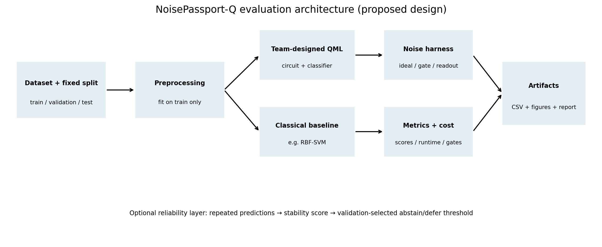

The intended workflow freezes a dataset split, fits preprocessing on training data only, evaluates the team-designed quantum model and a classical baseline, applies a named noise condition, and records scores and resources. An optional reliability layer can defer uncertain predictions using a threshold chosen on validation data only.

## 4. Experimental design

The source implementation guide recommends this matrix:

| Run | Condition | Purpose |
|---|---|---|
| A | Ideal simulator | Reference score |
| B1–B3 | Gate noise: low/medium/high | Gate-noise sensitivity |
| C1–C3 | Readout noise: low/medium/high | Measurement sensitivity |
| D (optional) | Combined gate + readout noise | Interaction of channels |
| E | Repeats across selected seeds | Estimate run variability |
| F | Classical baseline on same split | Reference performance and runtime |

Low/medium/high values must be explicitly defined. Unless rates come from a named backend calibration record, label them synthetic stress levels. Keep test labels out of model/noise/threshold selection. Fit preprocessing on training data only.

## 5. Metrics and formulas

| Metric | Definition | Interpretation |
|---|---|---|
| Accuracy | Correct predictions / all predictions | Overall correctness; may hide minority-class failures |
| Balanced accuracy | Mean recall across classes | Useful with class imbalance |
| Macro-F1 | Unweighted mean of per-class F1 | Gives each class equal weight |
| Performance drop | Ideal score − noisy score, in percentage points | Degradation relative to ideal |
| Accuracy retention | Noisy accuracy / ideal accuracy, if ideal > 0 | Fraction of ideal accuracy retained |
| Prediction flip rate | Paired test samples with noisy prediction different from ideal / test count | Instability under noise |
| Coverage | Number assigned a class / all test samples | How often the model predicts |
| Selective risk | Errors among assigned examples / assigned examples | Error rate among accepted predictions |
| Run variability | Mean ± standard deviation over independent repeats | Stochastic variability |

## 6. Illustrative performance comparison

### Accuracy vs noise

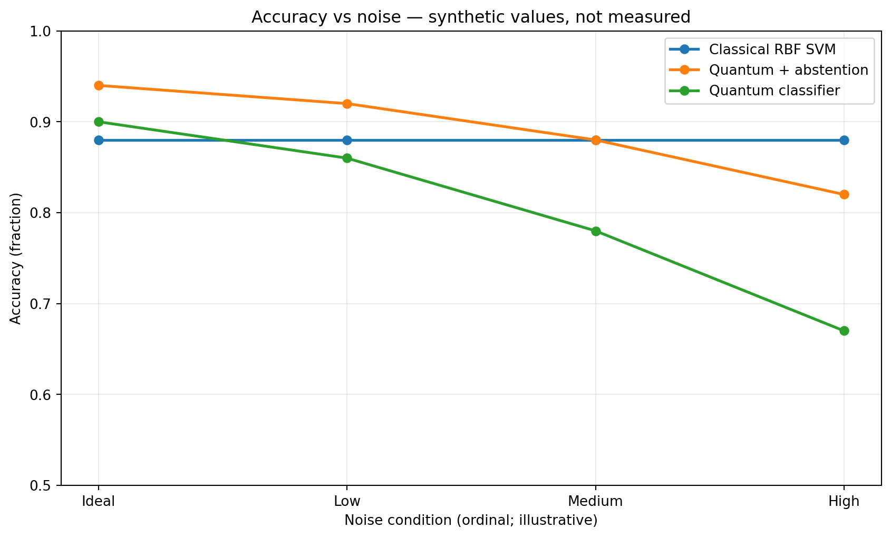

The supplied example quantum-classifier accuracy is 0.90 (Ideal), 0.86 (Low), 0.78 (Medium), and 0.67 (High). The example classical RBF-SVM accuracy is 0.88. These numbers are synthetic examples, not observations. The noise labels are ordinal stress labels, not calibrated physical probabilities.

### Macro-F1

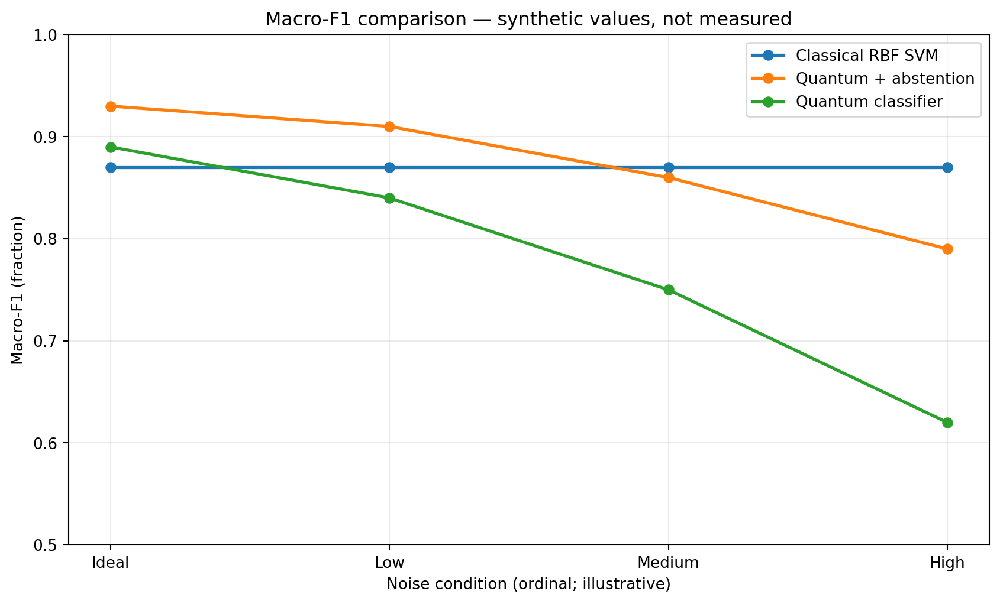

The example quantum Macro-F1 values are 0.89, 0.84, 0.75 and 0.62 across ideal-to-high conditions. The optional quantum-plus-abstention rows in the supplied model CSV are hypothetical. In real reporting, lower selective risk must be shown alongside coverage.

### Balanced accuracy

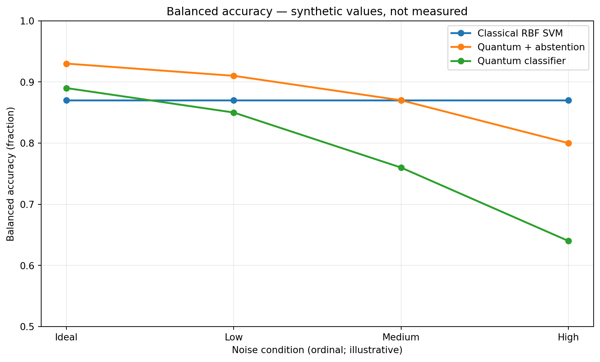

Balanced accuracy is included because overall accuracy can mask class-wise failure. Real analysis should include per-class recall/F1 where possible.

### Retention and prediction flips

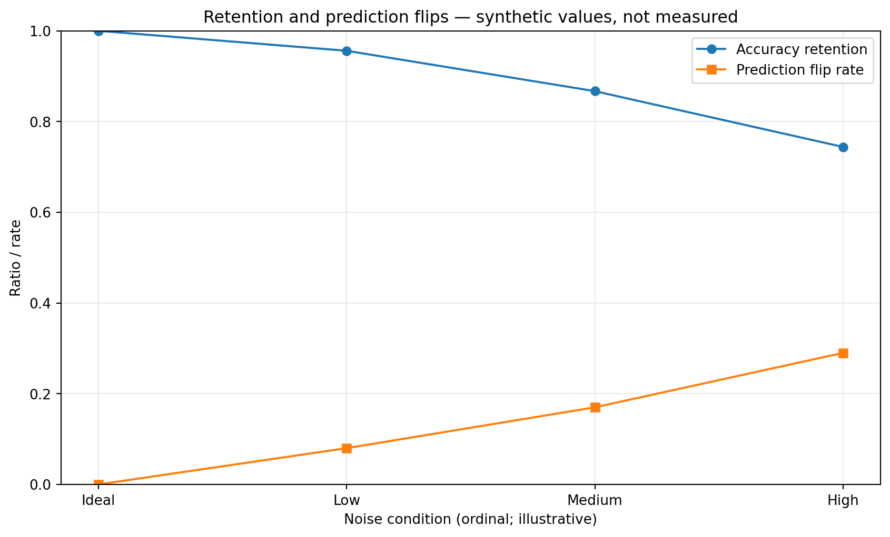

The supplied flip rates are illustrative and cannot be computed from raw predictions because no row-level prediction data were supplied. In the real experiment, compare predictions for identical held-out samples between ideal and noisy runs.

## 7. Resource usage

The resource CSV provides illustrative values for qubits, depth, two-qubit gates, shots, circuit evaluations, runtime and peak memory. Units differ, so each resource is shown in its own graph rather than combining unlike quantities on one axis.

### Runtime

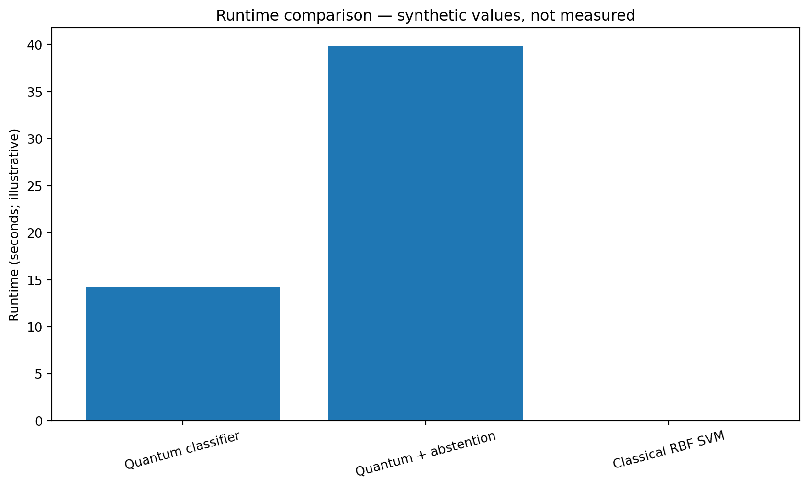

### Circuit evaluations

### Shots per evaluation

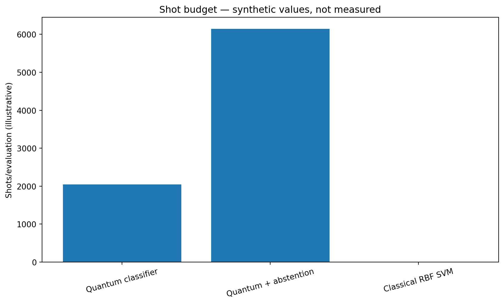

### Circuit depth

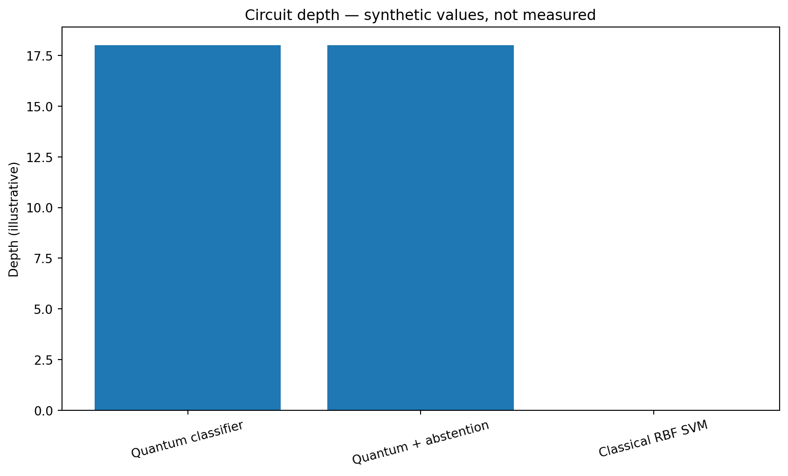

### Two-qubit gate count

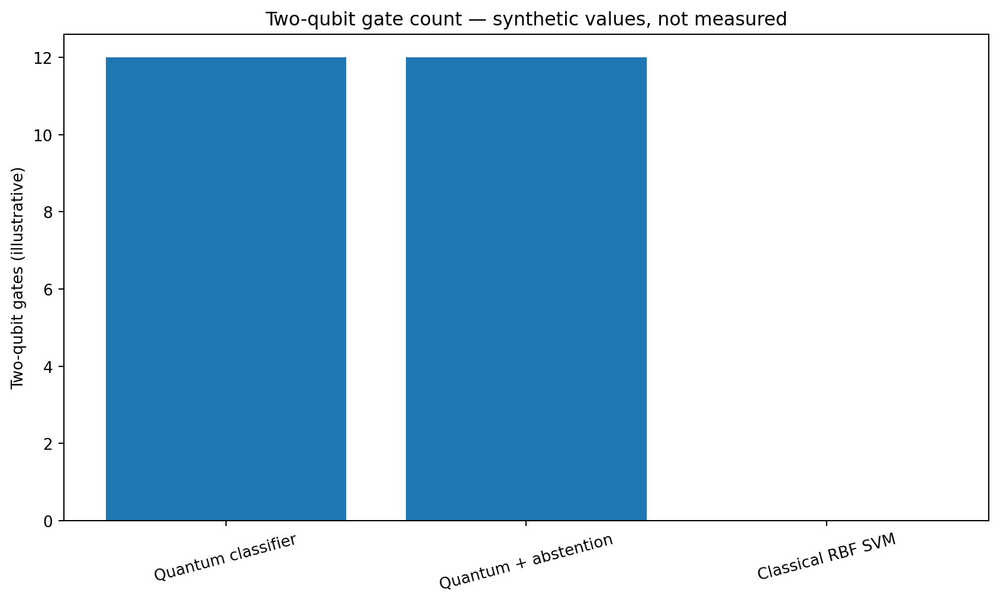

### Peak memory

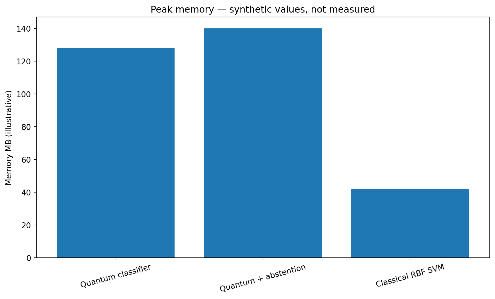

Example resource values copied from the supplied CSV:

| Model | Qubits | Depth | Two-qubit gates | Shots/evaluation | Evaluations | Runtime (s) | Peak memory (MB) |
|---|---:|---:|---:|---:|---:|---:|---:|
| Quantum classifier | 4 | 18 | 12 | 2,048 | 320 | 14.2 | 128 |
| Quantum + abstention | 4 | 18 | 12 | 6,144 | 960 | 39.8 | 140 |
| Classical RBF SVM | 0 | 0 | 0 | 0 | 1 | 0.08 | 42 |

**All values in this table are synthetic illustrative values.** They are not measured resource use.

## 8. Architecture impact and trade-offs

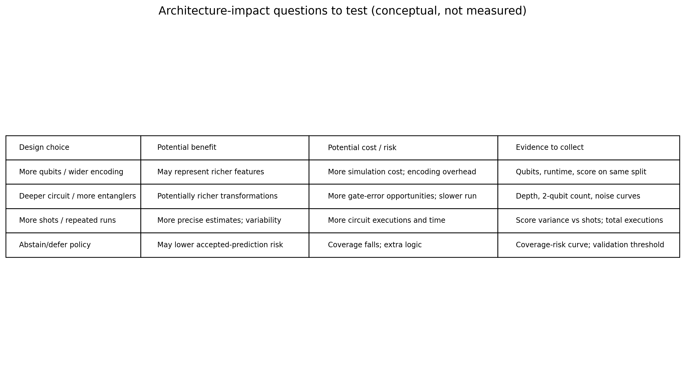

| Design choice | Potential benefit | Potential cost/risk | Evidence needed |
|---|---|---|---|
| More qubits / wider encoding | May represent richer features | More simulation cost and encoding overhead | Qubit count, runtime, score on same split |
| Deeper circuit / more entanglers | Potentially richer transformations | More gate-error opportunities and slower execution | Depth, gate count, noise-response curves |
| More shots / repeated runs | More precise estimates and variability assessment | More circuit executions and elapsed time | Score variance vs shots, total executions |
| Noise-aware training/mitigation | May help under target noise | Added implementation/training cost | Matched baseline and held-out results |
| Abstain/defer policy | May lower risk among accepted predictions | Lower coverage and extra decision logic | Coverage-risk curve with validation-selected threshold |

These are design hypotheses from the source reports, not experimentally verified effects.

## 9. Interpretation framework for actual results

1. Identify which tested noise channel produces the largest metric drop; generalize only to tested settings.
2. Inspect per-class recall/F1 rather than relying on accuracy alone.
3. Calculate flip rate from paired predictions on the same test examples.
4. Show selective risk and coverage together for an abstention policy.
5. Quantify performance changes against shots, evaluations, depth, gates and runtime.
6. Report mean and standard deviation across repeats; avoid significance claims based on a single run.

## 10. Reproducibility and environment

- Entry point: `main.py`
- Run: `python main.py`
- Test: `pytest -q`
- Dependencies: `requirements.txt`
- Environment record: `environment.txt`
- Noise profiles: `configs/processor_definitions.json`
- Input CSVs: `data/`

Record dataset source/license, split seed, run seed, Python/Qiskit/Aer versions, backend/simulator, exact noise parameters, shots, sample counts, circuit metadata, runtime boundaries, and failures. Measure resource values rather than estimating them.

## 11. Limitations and claim policy

- The CSV data and resulting plots are synthetic illustrative examples.
- This repository executes the analysis/reporting workflow, not the underlying quantum circuit.
- Processor profile parameters are example stress-test settings, not physical-device calibration.
- Hardware validation, statistical significance, and quantum advantage are not established.
- If the competition requires measured quantum execution, the team must implement and run its own circuit, export actual results, and update the report from those outputs.

## 12. Conclusion

The package gives a repeatable way to present performance, stability, resource usage, and architecture trade-offs. The scientifically correct next step is to replace illustrative values with measurements from the team-owned implementation and regenerate the same tables and figures. Report what the experiment shows, including negative or inconclusive findings.
